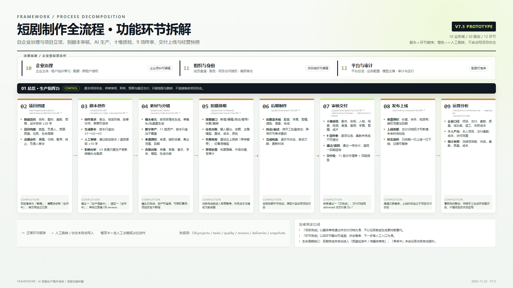
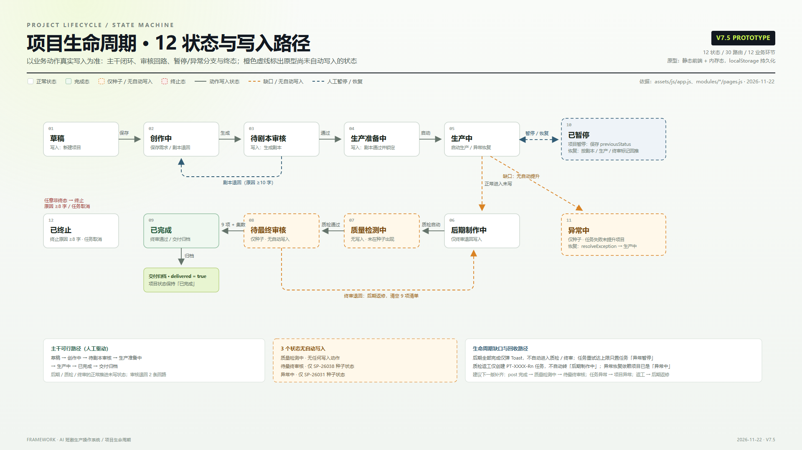

# 短剧制作流程功能拆解与生命周期（V7.5 原型）

本文把「短剧制作」从业务环节继续向下拆到**功能流程**：每个环节从哪进、点哪些动作、写了什么状态与数据、什么算完成、出错怎么回收。所有结论以 `prototype/v7` 的静态前端代码为准，不以业务方案的目标态替代现状。

阅读标记：

- **【闭环】** 动作有前置校验，写入项目状态或业务数据，并能被下一个页面消费。
- **【可操作不写项目态】** 动作真实修改列表数据，但项目 `status/stage` 不变。
- **【演示占位】** 只有 Toast、抽屉或下载，不产生真实媒体、真实模型调用或真实结算。
- **【缺口】** 方案中定义了状态，但代码中没有动作能把项目写入该状态。

证据来源：`assets/js/app.js`、`modules/{overview,workspace,studio,pipeline,assets,delivery,analytics,governance,people,platform}/pages.js`、`assets/js/data.js`。审计结论对应 V7.5，30 路由、5 身份、12 环节。

---

## 一、先给结论

原型已经具备「页面 + 动作 + 数据字段」的完整骨架，12 个业务环节都能操作，但**生命周期的自动推进只覆盖主干的一半**。

- 项目 12 个业务状态里，**9 个有真实动作写入**：草稿、创作中、待剧本审核、生产准备中、生产中、后期制作中、已完成、已暂停、已终止。
- **3 个没有自动写入路径**：`质量检测中` 无任何动作；`待最终审核` 与 `异常中` 只在种子项目里出现。
- 另有方案未列出的 **`已归档`**：项目归档动作会写入这个第 13 个状态值，归档恢复时再按标记回推，不能精确回到原状态。
- 后期流水线全部完成只弹 Toast，**不会**把项目推进到 `质量检测中` 或 `待最终审核`；十维质检复检只改质检行与项目质量分，**不会**推进项目状态。
- 生产任务重试达到上限，只把**任务**置为 `异常暂停`，**不会**把项目置为 `异常中`；项目异常恢复要求项目本身已经是 `异常中`，形成互锁。
- 新建项目可以走完立项、剧本、镜头、排期，但 `done`（已完成集数）没有任何正常动作会递增；`approveFinal()` 要求 `done >= episodes`，所以**新建项目无法从 UI 完成终审与交付**。可完整闭环的是带有 `done=episodes` 的种子项目。
- 交付归档不新增项目状态：写 `delivered=true`、`deliveredEpisodes=episodes`，项目仍是 `已完成`；发布上线是独立记录，不回写项目状态。

*图 1　端到端 12 环节与每环功能要点；虚线为人工推进或无状态写入。*

---

## 二、端到端主链路

主链路的业务顺序是：

治理底座 → 项目立项 → 剧本创作与审核 → 素材 / 分镜 → 拍摄排期与生产任务 → 后期制作 → 十维质检 → 成片终审 → 交付归档 → 渠道发布 → 经营分析。

其中真正承载「制作」的是 02—08 七个环节；01、09—12 分别是入口、经营、治理、组织与平台支撑。治理不是每一步的硬前置，只有身份权限、渠道授权、剧本锁定、交付状态这几处会被代码实际拦截。

### 2.1 环节 01 · 生产指挥台

- **入口条件**：已登录任一身份；当前租户存在；`accessibleProjects()` 能筛出项目。无项目时页面仍可进入，显示空态和「新建项目」。
- **操作路径**：`overview/home` 查看企业生产指标、待决事项、最近交付、异常与待审项目；点项目行进入项目档案；点「新建项目」直接开立项弹窗；点「刷新数据」只更新页面时间戳。
- **完成判定**：页面能按当前身份展示项目集合、待办与交付指标，即视为该环节可用。它不承担业务完成判定。
- **状态 / 数据写入**：`overview:refresh` 不写业务数据，只重渲染；项目行跳转按状态分流到 `pipeline/exceptions`、`studio/script-review` 或 `delivery/review`。**【可操作不写项目态】**
- **异常与回收**：没有项目时给空态并给立项入口；审计身份隐藏新建按钮；项目权限不足时列表为空，不会越权展示。
- **路由 / 动作 / 证据**：`overview/home`；`overview:refresh`、`project:new`、`go:*`。

### 2.2 环节 02 · 项目创建与档案

- **入口条件**：企业或租户身份可见「新建项目」；员工身份在项目中心也可立项；审计身份只读。当前租户必须有可用上下文。
- **操作路径**：
  1. 点「新建项目」，填写项目名称、题材、计划集数、单集时长、计划预算、创作目标。
  2. 提交后创建 `SP-2604x` 项目，自动切换当前项目并跳到 `studio/brief`。
  3. 在项目档案里可编辑名称、类型、题材、集数、时长、预算、截止日、优先级、创作目标；剧本锁定后集数只读。
  4. 项目档案另提供归档 / 恢复、暂停 / 恢复、终止、负责人移交、导出清单。
- **完成判定**：`DB.projects` 出现新记录，`state.projectId` 指向它，页面跳到创作需求，即立项完成。立项不等于制作完成。
- **状态 / 数据写入**：
  - 新建写 `status='草稿'`、`stage='创意策划'`、`done=0`、`scriptVersion=1`、`qualityState='待检测'`、`archived=false`、`scriptApproved=false`、`productionStarted=false`，并写 `DB.audits`。
  - 编辑写项目字段与 `updated`，不动状态；已归档 / 已终止项目拒绝编辑。
  - 归档写 `archived=true`、`status='已归档'`、`stage='已归档'`；恢复按 `delivered → 已完成`、`productionStarted → 生产中`、`scriptApproved → 生产准备中`、否则 `草稿` 回推。
  - 暂停保存 `previousStatus`，写 `status='已暂停'`、`stage='生产暂停'`；恢复不读 `previousStatus`，而是按 `finalApproved / productionStarted / scriptApproved` 标记回推。
  - 终止要求原因 ≥8 字，写 `terminated=true`、`status='已终止'`、`stage='已终止'`，把未执行 / 执行中任务置 `已取消`。
  - 移交写 `DB.projectHandovers`，记录 `from/to/reason/operator/time/kept`；项目归属企业不变。
- **异常与回收**：
  - 名称为空或不足 2 字被拒；集数越界被夹到 1–100；预算与时长做下限修正。
  - 已归档、已终止项目只读；终止项目不能归档、不能移交、不能暂停。
  - 移交仅企业 / 租户管理员可做，原因 <8 字被拒，新负责人不能等于原负责人。
  - **缺口**：暂停只改项目状态，未把 `productionTasks`、`schedule`、`postJobs` 停掉；页面文案「未完成任务停止调度」与实际行为不一致。
- **路由 / 动作 / 证据**：`workspace/projects`、`workspace/detail?id=`；`project:new`、`project:create`、`project:edit`、`project:update`、`project:archive`、`project:restore`、`project:pause`、`project:resume`、`project:terminate`、`project:terminate-submit`、`project:transfer`、`project:transfer-submit`、`project:export`。

### 2.3 环节 03 · 剧本创作与审核

- **入口条件**：存在当前项目；`scriptApproved=false` 才可生成新版本；创作需求、受众、视觉风格三项齐备。
- **操作路径**：
  1. 在 `studio/brief` 填写创作需求、目标受众、视觉风格、故事方向，保存草稿。
  2. 点「生成剧本」，系统把 `scriptVersion + 1`，生成候选版本并进入待审。
  3. 在 `studio/script-review` 查看版本、审核意见与审核记录，选择「通过并锁定」或「退回修改」。
  4. 剧本变更走影响分析：确认后只重生产受影响集次、镜头与音频，不整剧重做。
- **完成判定**：剧本审核通过且版本被锁定，`scriptApproved=true`，项目进入 `生产准备中`，下一环节才允许启动生产。
- **状态 / 数据写入**：
  - 保存草稿：要求需求 ≥20 字，写 `project.brief`；若当前是 `草稿`，改 `创作中`、`stage='创意策划'`，写审计。
  - 生成剧本：校验需求 ≥20 字、受众、视觉风格；写 `status='待剧本审核'`、`stage='剧本审核'`、`scriptVersion=next`；向 `DB.scriptVersions` 追加 `SV-{project}-{version}`，`status='待审核'`、字数取 `max(6000, episodes*1200)`；写 `DB.reviews` 与审计。
  - 审核通过：当前版本置 `已通过`；项目写 `status='生产准备中'`、`stage='导演分镜'`、`scriptApproved=true`；写审核记录与审计。**这是本轮修正点：原代码写「制作准备中」，与 12 状态口径不一致，已改为「生产准备中」。**
  - 退回：版本置 `退回修改` 并写退回原因；项目写 `status='创作中'`、`stage='剧本修改'`、`scriptApproved=false`；写审核记录与审计。
  - 影响分析确认：`impact.status='已确认'`；若不存在同阶段任务，创建 `PT-...-IA` 任务，`status='待执行'`、`stage='剧本影响重生产'`。
- **异常与回收**：
  - 需求 <20 字、未选受众、未选视觉风格均拒绝生成，并定位字段。
  - 已通过剧本重复生成 / 重复审核被拒；`待剧本审核` 状态不能重复生成。
  - 退回原因 <10 字被拒；退回不清空剧本版本，只改版本状态与项目状态。
  - 版本抽屉、剧本下载均为演示内容，下载文件只含项目元信息，不含真实剧本文本。
- **路由 / 动作 / 证据**：`studio/brief`、`studio/script-review?id=`；`script:draft`、`script:versions`、`script:download`、`script:return`、`script:return-submit`、`script:approve`；核心方法 `generateScript()`、`approveScript()`、`returnScript()`；`impact:apply`。

### 2.4 环节 04 · 素材与分镜

- **入口条件**：项目已创建；剧本是否通过不影响进入资产 / 镜头页，但实际生产语义上应在剧本锁定后使用。
- **操作路径**：
  1. 在 `pipeline/shots` 查看项目派生的镜头生产单元，单镜头「重新生成」或整批「批量生成」。
  2. 在 `assets/library?id=` 登记资产，选择类型、版本、格式、来源、授权依据、商业范围、到期日。
  3. 对资产创建新版本，填写 ≥5 字变更说明；旧版本进入 `history`。
  4. 查看合规台账，核对肖像、声音、音乐、字体、模型条款与到期状态。
- **完成判定**：
  - 镜头：状态从 `生成中` 回到 `已完成`，且更新时间落库，视为该镜头完成。
  - 资产：记录出现在项目资产目录，版本与授权字段齐全，视为可被下游引用。
- **状态 / 数据写入**：
  - 镜头由 `ensureShots(project)` 派生，最多 12 个单元；按项目完成比例预置 `已完成 / 待生成`。单镜头提交写 `生成中`，约 2.2 秒后写 `已完成` 与 `updated`；批量提交把所有未完成单元置 `生成中`，约 2.6 秒后统一 `已完成`。镜头动作**不创建** `DB.productionTasks`，也不改项目 `done`。
  - 资产新建写 `DB.assets`，字段含 `id/name/type/project/version/owner/tenant/format/origin/license/commercial/expires/note`；新版本把旧值压入 `history`，更新 `version/name/note/date`；删除从目录移除并写审计。
  - 合规台账读 `DB.compliance`，只读展示，不改状态。
- **异常与回收**：
  - 镜头已在 `生成中` 时拒绝重复提交；没有待生成单元时批量动作提示空。
  - 资产名称 / 类型必填；版本号必须匹配 `V数字` 且不能等于当前版本；变更说明 <5 字被拒。
  - **缺口**：镜头生成是独立演示计时器，不进入统一任务台账，不参与成本、失败重试、并发配额与项目进度。
- **路由 / 动作 / 证据**：`pipeline/shots`、`assets/library?id=`；`shot:view`、`shot:regen`、`shot:batch`、`asset:new`、`asset:create`、`asset:view`、`asset:download`、`asset:version`、`asset:version-submit`、`asset:delete`、`compliance:view`。

### 2.5 环节 05 · 拍摄排期与生产任务

- **入口条件**：新增排期要求 `scriptApproved=true`；编辑排期只要求记录存在；任务台账按项目读取 `DB.productionTasks`。新建项目默认没有生产任务。
- **操作路径**：
  1. 在 `pipeline/schedule` 新增 / 编辑排期窗口，填集次范围、生产环节、起止日期、单元数、负责人、备注。
  2. 启动 / 暂停 / 恢复 / 删除排期窗口。
  3. 在 `pipeline/tasks?id=` 查看任务输入、输出、依赖、模型、备用模型、重试次数、成本、失败原因、质检分。
  4. 对失败任务执行「重试」或「切换备用模型」；也可暂停任务。
  5. 异常任务在 `pipeline/exceptions` 里处置：恢复策略、切换能力、升级协同，并写审计。
- **完成判定**：
  - 排期：窗口进入 `执行中` 只代表调度开启，不等于生产完成；删除后不再参与调度。
  - 任务：状态到 `已完成` 且 `quality>0`、`finishedAt` 有值，才算任务完成。
- **状态 / 数据写入**：
  - 排期新增写 `DB.schedule`，状态 `待开工`；启动 / 恢复写 `执行中`；暂停写 `已暂停`；删除移出数组。排期状态**不回写项目状态**。
  - 任务重试仅允许 `失败待重试` 或 `异常暂停`；`attempt += 1`、`cost += 10`、状态 `执行中`，1.6 秒后 `已完成`、`quality=90`、清空 `failure`。
  - 切换备用模型：`model` 换为 `backup`、`backup` 置为「同类备用模型自动切换」、`attempt += 1`、`cost += 8`、`status='执行中'`，1.8 秒后 `已完成`、`quality=91`。
  - 暂停任务直接写 `异常暂停` 与 `finishedAt`，等待人工决策。
  - 达到 `attempt >= maxAttempts` 时只把任务置 `异常暂停`，写审计，**不提升项目状态**。
- **异常与回收**：
  - 排期结束早于开始被拒；集次范围或环节为空被拒；剧本未通过不能新增排期。
  - 任务没有备用模型时不能切换；非失败 / 异常任务不能重试；任务暂停后只能通过重试或切模型恢复。
  - **缺口**：启动生产不生成任务；排期启动不生成任务；任务完成不增加项目 `done`。因此任务台账的闭环与项目进度是两套数据。
- **路由 / 动作 / 证据**：`pipeline/board`、`pipeline/schedule`、`pipeline/tasks?id=`、`pipeline/exceptions`；`schedule:new`、`schedule:edit`、`schedule:save`、`schedule:start`、`schedule:resume`、`schedule:pause`、`schedule:delete`、`task:view`、`task:retry`、`task:switch-model`、`task:pause`、`task:export`、`exception:resolve`、`exception:resolve-submit`、`exception:escalate`。

### 2.6 环节 06 · 后期制作

- **入口条件**：项目存在；`DB.postJobs` 中存在该项目的 `待开工` 或 `异常暂停` 环节。新建项目没有后期作业，必须先有种子数据或后续补齐生成逻辑。
- **操作路径**：
  1. 在 `pipeline/post` 查看配音、字幕、剪辑、调色、混音、合成等环节。
  2. 「启动后期」批量把待开工 / 异常暂停环节置为执行中，异常环节按「切换备用能力」处理。
  3. 单环节异常可重试；完成后查看环节状态、尝试次数与更新时间。
- **完成判定**：所有后期环节 `已完成`，页面提示「可提交成片终审」。但项目状态与 `stage` 不被改写。
- **状态 / 数据写入**：
  - `post:start`：待开工 / 异常暂停 → `执行中`，`attempts += 1`，2.4 秒后全部 `已完成`；写审计。
  - `post:retry`：单环节 → `执行中`，`attempts += 1`，2 秒后 `已完成`；写审计。
  - 两者都**不写** `project.status`、`project.stage`、`project.done`。
- **异常与回收**：
  - 没有待启动环节时提示空；异常环节只按「备用能力」文案处理，不真正切换模型记录。
  - **缺口**：后期完成后不进入 `质量检测中` 或 `待最终审核`；项目仍停在 `生产中`，下一步只能靠人工跳页。
- **路由 / 动作 / 证据**：`pipeline/post`；`post:start`、`post:retry`、`post:view`。

### 2.7 环节 07 · 十维质检、终审与交付

- **入口条件**：
  - 质检：`pipeline/quality?id=` 读取 `DB.qualityChecks`，按项目展示十维记录。
  - 终审：`delivery/review?id=` 要求 `done >= episodes`，且 9 项清单全部勾选；`reviewChecks.length >= 9`。
  - 交付归档：`delivery/center?id=` 要求 `finalApproved=true`；已交付后禁止重复归档。
- **操作路径**：
  1. 在质量页对单维执行「独立复检」或「局部返工」；导出质量报告。
  2. 在终审页逐项确认 9 项清单，填写审核意见，点「审核通过」或「退回返修」。
  3. 在交付中心生成交付包并归档；导出交付清单、生产报告、质量报告、成本报告、合规摘要。
- **完成判定**：
  - 质检：复检后该维 `status='通过'`、`score=93`、`issues=0`，项目质量状态按十维汇总重算。
  - 终审：`finalApproved=true`、项目 `已完成`、`stage='交付准备'`、`qualityState='已通过'`，写审核记录与审计。
  - 交付：`delivered=true`、`deliveredEpisodes=episodes`、项目 `已完成`、`stage='已归档'`，生成 `DL-*` 交付记录。
- **状态 / 数据写入**：
  - 十维：剧本质量、内容合规、人物一致性、场景一致性、视频质量、表演质量、音频质量、字幕质量、剪辑质量、成片质量。复检固定把该维置通过并重算项目质量；局部返工把该维置 `返工中`、项目 `qualityState='待返工'`，并创建 `PT-...-Rn` 返工任务（同一目标不重复创建）。
  - 终审：通过写 `project.finalApproved=true`、`status='已完成'`、`stage='交付准备'`、`qualityState='已通过'`；写 `DB.reviews` 与审计。退回要求原因 ≥10 字，写 `finalApproved=false`、`status='后期制作中'`、`stage='后期返修'`，清空 `reviewChecks`，写审核记录。
  - 交付：创建 `DL-*`，`files=episodes+9`、`size='17.4 GB'`、`status='已归档'`；写 `delivered` 与 `deliveredEpisodes`、`done=episodes`；写审计。
  - 交付清单固定 11 类；报告分别导出生产、质量、成本、合规 CSV。
- **异常与回收**：
  - 集数未完成不能终审；清单不足 9 项被拒；已交付 / 已通过终审的项目拒绝重复操作。
  - 终审退回把项目拉回 `后期制作中`，但不清空后期环节完成状态，也不重新生成后期任务；再次终审仍依赖原 `done`。
  - **缺口**：交付报告按钮在未终审时也可导出，报告先于正式交付可用；`delivery:manifest` 动作本身无 `delivered` 守卫，仅页面按钮按 `delivered` 隐藏。
- **路由 / 动作 / 证据**：`pipeline/quality?id=`、`delivery/review?id=`、`delivery/center?id=`；`quality:recheck`、`quality:rework`、`quality:report`、`final:approve`、`final:reject`、`final:reject-submit`、`review:preview`、`review:export`、`delivery:manifest`、`delivery:report`；核心方法 `approveFinal()`、`publishDelivery()`。

### 2.8 环节 08 · 渠道发布

- **入口条件**：`delivered=true` 才能新增排期；至少一个渠道 `status='已授权'`；计划上线时间不得早于当前时间（允许 1 分钟容差）。
- **操作路径**：
  1. 在 `delivery/release` 查看渠道授权、已上线 / 已排期数量、交付状态。
  2. 企业身份可对 `待授权` 渠道执行授权；租户只能选已授权渠道。
  3. 新增上线排期，选择渠道、计划时间、备注；对 `已排期` 记录执行「上线」，对 `已上线` 执行「下线」，任意记录可删除。
- **完成判定**：发布记录进入 `已上线`，`slot` 改写为实际上线时间，即单渠道发布完成。项目状态不变。
- **状态 / 数据写入**：
  - 渠道授权写 `channel.status='已授权'`、`scope='按租户申请范围'`。
  - 新增排期写 `DB.releases`，`status='已排期'`，字段含 `project/tenant/channel/slot/note/operator/updated`。
  - 上线写 `status='已上线'`、`slot=nowStamp()`；下线写 `已下线`；删除移出数组。均写审计并保存。
- **异常与回收**：
  - 未交付、渠道未授权、时间无效或早于当前时间均拒绝。
  - 发布状态独立于项目：项目 `已完成` 后仍可下线、删除；删除不删项目交付记录。
  - 发布只记录演示数据，不触达真实平台。
- **路由 / 动作 / 证据**：`delivery/release`；`release:new`、`release:create`、`release:publish`、`release:offline`、`release:remove`、`channel:authorize`。

### 2.9 环节 09 · 运营分析

- **入口条件**：`analytics/enterprise` 需企业级可见范围；`analytics/employee` 需组织视角；`analytics/me` 对员工开放。项目 / 任务 / 交付数据存在才能出指标。
- **操作路径**：切换统计周期；查看企业项目、交付、集数、质量、成本、预算；查看员工产出与个人项目；生成经营快照；导出经营摘要、员工产出、本人产出。
- **完成判定**：指标按当前实时数据聚合；生成快照后 `DB.analyticsSnapshots` 出现一条冻结记录，才算本期经营数据留档。
- **状态 / 数据写入**：
  - 周期切换只改 `App.analyticsPeriod`，不落库。
  - 快照写 `SN-MMDDHHmm`、`capturedAt`、项目数、交付作品数、交付集数、平均质量、总成本、失败成本、操作人、备注；写 `DB.analyticsSnapshots` 与审计。
  - 导出均为 CSV，写审计；不改项目状态。
- **异常与回收**：无可聚合数据时指标为 0；快照为手工冻结，不自动按日生成；成本为演示归集值，不代表真实结算。
- **路由 / 动作 / 证据**：`analytics/enterprise`、`analytics/employee`、`analytics/me`；`analytics:period`、`analytics:snapshot`、`analytics:export-enterprise`、`analytics:export-people`、`analytics:me-export`、`analytics:member`。

### 2.10 环节 10 · 企业治理

- **入口条件**：企业级管理员可见企业主体、租户、跨租户授权；租户管理员只见本租户范围；审计身份只读。
- **操作路径**：维护企业名称 / 主体信息；维护配额、重试上限、并发、预算、留存等策略；新建 / 编辑 / 停用 / 恢复 / 归档租户；创建跨租户授权并撤销。
- **完成判定**：企业或租户字段保存成功，`DB.enterprise / DB.tenants / DB.crossAuthorizations` 更新，写审计；租户归档后只读。
- **状态 / 数据写入**：
  - 企业信息与策略写 `DB.enterprise`；租户写 `DB.tenants`，状态含 `运行中 / 已停用 / 已归档`。
  - 跨租户授权写 `DB.crossAuthorizations`，撤销置 `已撤销`。
  - 默认策略值：项目预算 60,000、12 集、重试 3、并发 12、提醒 80%、留存 36 个月、审计 5 年。
- **异常与回收**：租户归档 / 项目归档为只读；已撤销授权不能再次撤销；跨租户授权不等于素材读取权，资产复用仍按租户边界。
- **路由 / 动作 / 证据**：`governance/enterprise`、`governance/tenants`、`governance/tenant-detail?id=`、`governance/cross-access`；`enterprise:edit`、`enterprise:update`、`enterprise:policy-edit`、`enterprise:policy-update`、`tenant:edit`、`tenant:update`、`tenant:disable`、`tenant:restore`、`tenant:archive`、`cross:new`、`cross:create`、`revokeAuthorization()`。

### 2.11 环节 11 · 组织与身份

- **入口条件**：企业 / 租户管理员可管理成员与角色；审计身份只读；员工只看本人。
- **操作路径**：邀请成员；查看成员详情；授予项目访问权；调整角色；重发邀请；停用 / 启用；移除成员；查看角色权限矩阵。
- **完成判定**：成员字段或授权集合保存成功并写审计，即完成一次组织变更；移除要求先移交名下项目。
- **状态 / 数据写入**：
  - 成员状态含 `正常 / 待邀请 / 已停用`；项目授权写 `member.projectAccess` 与 `member.access`，不与租户成员关系绑定。
  - 角色变更写 `member.role`，即时生效；项目归属与历史记录不变。
  - 移除成员解除成员关系，要求 `projects=0`，否则拒绝并提示先移交。
- **异常与回收**：仍有负责项目时不能移除；停用保留历史项目、成本与审计；邀请重发只改 `lastActive`。
- **路由 / 动作 / 证据**：`people/members`、`people/roles`；`member:view`、`member:access`、`member:access-submit`、`member:role`、`member:role-submit`、`member:resend`、`member:disable`、`member:enable`、`member:remove`、`role:view`。

### 2.12 环节 12 · 平台与审计

- **入口条件**：平台运维管理员可见平台总览、业务配置、审计、模型、系统；其他身份按权限只读或不可见。
- **操作路径**：查看平台总览；编辑业务配置；查看 / 刷新 / 导出审计；切换模型与备用模型；测试模型；执行备份、清缓存、重启、重置演示数据。
- **完成判定**：配置保存、模型切换、审计导出、系统动作产生 Toast 与审计，即视为平台侧操作完成。
- **状态 / 数据写入**：
  - 配置写 `DB.runtime` / `DB.enterprise.policies` 相关字段；模型写 `DB.models` 的主备与状态；审计写 `DB.audits`。
  - `system:reset` 重置为种子数据，属于演示动作，不是生产恢复。
- **异常与回收**：模型不可用时提示切换备用；系统动作只做演示提示；平台总览不做项目状态推进。
- **路由 / 动作 / 证据**：`platform/overview`、`platform/config`、`platform/audit`、`platform/models`、`platform/system`；`platform:config-edit`、`platform:config-update`、`audit:view`、`audit:refresh`、`audit:export`、`model:switch`、`model:switch-submit`、`model:test`、`system:backup`、`system:cache`、`system:restart`、`system:reset`。

---

## 三、项目生命周期

### 3.1 12 个业务状态 + 1 个冻结态

**01 草稿**：新建项目唯一写入。`stage='创意策划'`、`scriptVersion=1`、`done=0`。可保存创作需求进入创作中，或直接终止。

**02 创作中**：保存创作草稿时从草稿进入；剧本退回时从待审进入。`stage` 分别为 `创意策划 / 剧本修改`。可再次生成剧本，或终止。

**03 待剧本审核**：`generateScript()` 写入。`stage='剧本审核'`，同时追加剧本版本与待审记录。只能通过或退回。

**04 生产准备中**：`approveScript()` 写入。`stage='导演分镜'`、`scriptApproved=true`。归档恢复、项目恢复也可回到此态。可启动生产。

**05 生产中**：`startProduction()` 写入；`resolveException()` 从异常中恢复也写入，`stage='音频合成'`；归档恢复、项目恢复可回到此态。`productionStarted=true`。**从这里没有正常动作写入后期制作中。**

**06 后期制作中**：当前唯一写入是终审退回（`final:reject-submit`），`stage='后期返修'`。正常启动后期不写这个状态。可人工跳到终审页。

**07 质量检测中**：无任何动作写入，种子数据中也未出现。属于方案定义但原型不可达的状态。

**08 待最终审核**：仅 SP-26038 种子项目使用；提交质检、后期完成都不会写入。属于「有状态、无入口」。

**09 已完成**：`approveFinal()` 与 `publishDelivery()` 写入；项目恢复且 `finalApproved=true` 也回到此态；归档恢复且 `delivered=true` 也回到此态。`stage` 分别为 `交付准备 / 已归档`。

**10 已暂停**：`project:pause` 从任意非终止、非归档状态写入，保存 `previousStatus`，`stage='生产暂停'`。恢复按 `finalApproved / productionStarted / scriptApproved` 三分支回推，不使用 `previousStatus`。

**11 异常中**：仅 SP-26031 种子项目使用；任务失败、重试上限、异常升级都不会写入项目 `异常中`。`resolveException()` 只对已经是异常中的项目生效，恢复为生产中。

**12 已终止**：`project:terminate-submit` 写入，要求原因 ≥8 字，`terminated=true`，`stage='已终止'`，未执行 / 执行中任务置 `已取消`。终态，只读。

**附：已归档**：`project:archive` 写入，`archived=true`、`status='已归档'`、`stage='已归档'`。这是 12 状态之外的冻结态，用于项目列表与只读守卫，不应计入业务生产状态。

### 3.2 状态写入矩阵（文字版）

- 由新建写入：草稿。
- 由创作动作写入：创作中、待剧本审核、生产准备中。
- 由生产动作写入：生产中。
- 由审核退回写入：后期制作中。
- 由终审 / 交付写入：已完成。
- 由管理动作写入：已暂停、已终止、已归档。
- 由种子数据提供：待最终审核、异常中。
- 无写入：质量检测中。

*图 2　12 状态、写入路径与三个无自动写入状态。虚线表示缺口或人工暂停分支。*

### 3.3 主干可行路径与断点

代码真实可走的一条主干是：

草稿 → 创作中 → 待剧本审核 → 生产准备中 → 生产中 → 已完成 → 交付归档。

这条路径的每一跳都有明确动作，但中间依赖人工跨页操作：启动生产后不会自动生成任务，后期完成不会自动进入质检 / 终审，交付前必须手工通过 9 项终审。新建项目还会卡在 `done` 门槛。

正常后期链路在方案中是：

生产中 → 后期制作中 → 质量检测中 → 待最终审核 → 已完成。

代码中只有最后两跳（待最终审核 → 已完成）中的「已完成」有写入动作；前三跳均无自动写入。终审退回反而会把项目拉回后期制作中，形成一条「异常回流」而非正常前进。

### 3.4 审核状态

- 剧本审核记录：`待审核 / 通过 / 退回修改`，版本绑定 `V{n}`。
- 成片审核记录：`通过 / 退回修改`，版本写 `V{n} 成片`。
- 审核记录字段：`project/type/subject/version/reviewer/time/result/note/tasks/followup`。
- 剧本通过会锁版本；成片通过会锁 `finalApproved`；退回会清空终审清单。审核记录本身没有独立待办状态，只有结果字符串。

### 3.5 交付状态

- 页面派生三态：`待终审`（未 `finalApproved`）、`待生成交付包`（已终审未交付）、`已归档`（`delivered=true`）。
- 实际数据字段只有 `DB.deliveries[].status='已归档'`；项目状态仍为 `已完成`。
- 交付记录字段：`id/project/tenant/manifest/files/size/status/createdAt/operator`。
- 归档后 `deliveredEpisodes=episodes`、`done=episodes`；这是代码中唯一会把 `done` 补齐到集数的动作。

### 3.6 发布状态

- 渠道状态：`待授权 / 已授权`。
- 发布记录状态：`已排期 → 已上线 → 已下线`；删除是移除记录，不是状态。
- 发布不改变项目状态，也不改变交付状态；项目完成后仍可新增、下线、删除渠道记录。
- 上线前置是交付归档，不是终审通过；终审通过但未归档时只能看发布页，不能新增排期。

### 3.7 任务与后期作业状态

生产任务 6 态：`待执行 / 执行中 / 失败待重试 / 异常暂停 / 已完成 / 已取消`。

- `待执行` 由种子任务或返工 / 影响分析创建。
- `执行中` 由重试、切换模型、异常恢复写入。
- `失败待重试` 由种子或失败场景提供，代码中没有失败注入入口。
- `异常暂停` 由重试达上限、任务暂停、异常策略写入。
- `已完成` 由重试 1.6 秒、切模型 1.8 秒后写入。
- `已取消` 由项目终止写入。

后期作业 5 态：`待开工 / 执行中 / 已完成 / 异常暂停 / 待终审`。启动 2.4 秒批量完成，单环节重试 2 秒完成；`异常暂停` 只由种子提供，代码没有把已完成环节改回异常的入口。

### 3.8 跨对象状态一致性

- 项目 `done` 与任务完成数、镜头完成数、后期完成数均不联动；只有交付归档会把 `done` 补齐。
- 项目 `quality` / `qualityState` 由十维记录汇总，复检与返工会更新，但不会触发项目 `质量检测中`。
- 项目 `productionStarted` 只由启动生产写入，终止、暂停、归档都不复位；恢复时按它回推。
- 项目 `finalApproved` 只由终审通过写入，终审退回清除；交付归档不复位。
- 项目 `delivered` 只由交付归档写入，之后没有撤销入口；终审退回也不清除 `delivered`。

---

## 四、原型闭环与缺口清单

### 4.1 已经闭环的功能

- 立项：新建 → 草稿 → 创作需求页。
- 剧本：草稿 → 待审 → 通过 / 退回，版本追加、审核记录、审计齐全。
- 镜头：单镜头 / 批量演示生成，状态与更新时间落库。
- 资产：登记、版本、详情、下载占位、删除，授权与合规字段齐全。
- 排期：新增 / 编辑 / 启动 / 暂停 / 恢复 / 删除。
- 任务：查看、重试、切模型、暂停、导出；失败成本与尝试次数保留。
- 后期：批量启动、单环节重试、完成提示。
- 质检：十维复检、局部返工、报告导出。
- 终审：9 项清单、通过 / 退回、结构化记录。
- 交付：归档、交付单、11 类清单、四类报告。
- 发布：渠道授权、排期、上线、下线、删除。
- 经营：周期切换、快照、三类导出。
- 治理 / 组织 / 平台：主体、租户、授权、成员、角色、配置、模型、审计、系统动作。

### 4.2 阻断完整闭环的缺口

**P0 · 新建项目无法终审交付。** `done` 只在 `publishDelivery()` 里被补齐，而 `publishDelivery()` 又要求 `finalApproved`；`approveFinal()` 要求 `done>=episodes`。新建项目没有任务、后期作业，也没有任何递增 `done` 的动作，形成死锁。演示只能靠 SP-26038 等种子项目。

**P0 · 后期完成不推进项目态。** `post:start` 完成后只弹 Toast，不写 `质量检测中 / 待最终审核`，项目仍停在 `生产中`。正常后期链路在状态层是断的。

**P0 · 三个状态无入口。** `质量检测中` 无写入；`待最终审核`、`异常中` 只有种子。页面能显示，但没有动作能把项目送进去。

**P1 · 任务异常不升级项目。** 重试达上限只置任务 `异常暂停`；项目 `异常中` 不会出现，异常处置页只能对种子项目生效。

**P1 · 质量返工不回后期。** 返工只建 `PT-...-Rn` 任务、把该维置 `返工中`，不把项目转 `后期制作中`，也不在返工完成后自动复检。

**P1 · 暂停没有真正停任务。** `project:pause` 只改项目状态与阶段，不暂停 `productionTasks`、`schedule`、`postJobs`，与页面承诺不一致。

**P1 · 归档引入第 13 个状态。** 归档写 `已归档`，恢复按标记粗回推，无法精确回到暂停、待审、异常等状态；`previousStatus` 在归档路径未使用。

**P2 · 报告先于终审可用。** 交付报告按钮在未终审时也展示；`delivery:manifest` 动作无 `delivered` 守卫，仅靠按钮隐藏。

**P2 · 镜头 / 后期不进统一台账。** 镜头生成、后期作业都不写 `DB.productionTasks`；统一任务台账只覆盖种子任务与返工 / 影响分析任务，成本、并发、重试口径不完整。

**P2 · 演示边界。** 所有生成、后期、发布、报告均为静态前端演示；不接真实模型、不生成真实媒体、不触达真实渠道、不做真实结算。

### 4.3 建议补齐顺序

1. `startProduction()` 物化生产任务与后期作业，按集建立 `done` 统计口径。
2. `post:start` 完成时写 `status='质量检测中'`、`stage='质量检测'`；全部十维通过后再写 `待最终审核`、`stage='最终审核'`。
3. 任务重试达上限、异常升级时同步项目 `异常中`；`resolveException()` 恢复后回 `生产中`。
4. 质量返工把项目转 `后期制作中`，返工任务完成回调复检，复检通过再回 `质量检测中`。
5. 暂停 / 恢复改用 `previousStatus`，并同步暂停任务、排期、后期作业。
6. 归档恢复改用 `previousStatus`，不要按标记猜测。
7. 给交付报告与清单动作补 `finalApproved / delivered` 守卫，避免越序导出。

---

## 五、验证与边界

- `node --check assets/js/app.js` 与 `node --check modules/delivery/pages.js` 通过。
- jsdom 回归：10 业务域、30 路由、5 身份、0 失败、0 控制台错误、0 告警。
- Playwright 交互回归：36 项全过，覆盖租户编辑、跨租户授权、上线排期、终审 9 项、模型切换、快照、授权与持久化。
- 流程全景图 1920×1080，`scrollWidth=1920`、`scrollHeight=1080`，无裁切、无页面错误。
- 生命周期图 1920×1080，`scrollWidth=1920`、`scrollHeight=1080`，无页面错误。
- 本轮只改了一处业务代码：`approveScript()` 的 `制作准备中 → 生产准备中`。其余为文档与配图，未新增功能。
- V7.5 仍是静态原型：业务方案 20.2 / 20.3 / 20.5 的真实 AI 生产与端到端交付不在实现范围。
