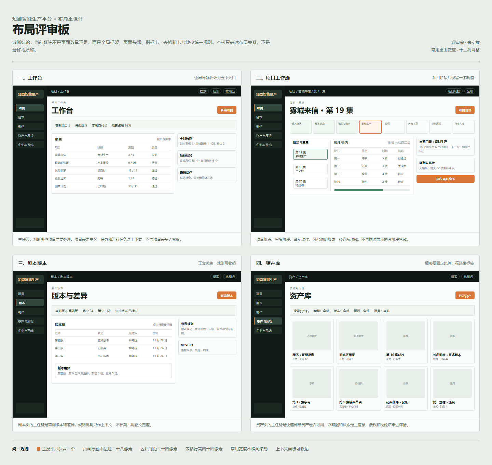

# 布局诊断与重设计方案

- 状态：评审稿，未实施
- 日期：二零二六年十一月二十八日
- 范围：全局框架、工作台、项目工作流、剧本版本、资产库、质量报告、时间线、交付包
- 说明：本方案只做诊断与设计，不修改生产页面代码，待确认后再进入实现



评审板用于快速查看四个核心页面的布局关系，正文用于逐项核对问题与规则。评审板是静态示意，不是最终界面。

## 一、诊断范围与方法

本次诊断以当前可运行页面为准，在常用桌面宽度下逐页检查，并结合页面结构、样式规则和实际操作路径判断问题。

检查页面包括：

1. 工作台与项目列表。
2. 项目详情与单集工作区。
3. 剧本版本与版本链。
4. 资产库。
5. 质量报告。
6. 时间线与剪辑。
7. 交付包。
8. 重建版项目概览。

诊断重点不是单个页面好不好看，而是全局框架是否稳定、同类页面是否遵循同一套排版规则、用户能否按业务顺序完成操作。

## 二、总体结论

当前系统的功能密度已经很高，但布局仍按早期原型的方式不断叠加，主要问题集中在五个方面：

1. 全局导航承载了过多入口，侧栏常驻五十个可见菜单项，用户很难快速判断当前该去哪里。
2. 页面头部层级重复。面包屑、项目选择器、页面标题、阶段标签、页面动作和多处状态徽标同时争夺注意力。
3. 同一套大卡片模板被套到所有页面。指标卡、表格、空状态、右侧说明卡都使用相近的体量和视觉权重，主次不分。
4. 深色外壳与浅色新页面并存，旧页面用深色卡片，新项目概览用浅色工作区，用户会感觉进入了两个产品。
5. 关键操作不总在关键位置。项目级动作、单集动作、页面动作分散在顶部、卡片内和底部，操作动线不连续。

## 三、问题清单

### 一、全局框架与导航

1. 侧栏入口过多。当前侧栏有五十个可见菜单项，分六组，多个二级分组同时展开，纵向滚动明显。用户进入系统后先面对的是功能目录，而不是当前任务。
2. 侧栏层级过深。分组、子分组、菜单项形成三层结构，但多数用户日常只使用项目、剧本、制作、资产与质检四类入口，低频功能占用了主要视觉空间。
3. 侧栏底部用户卡和重置按钮常驻，占用固定高度。重置验证数据属于环境操作，不应与身份卡一起长期占据主视区。
4. 顶栏项目选择器与页面标题重复。工作台已经显示当前项目，顶栏仍保留一个项目下拉框，信息重复且切换语义不清。
5. 顶栏元素过多。面包屑、项目选择器、数据模式徽标、通知、身份切换同时出现，数据模式徽标的视觉权重接近业务动作。
6. 侧栏当前项高亮使用整行深色块，和页面内部的强调色不统一，用户需要在两套强调规则之间切换。

### 二、页面头部

7. 页面头部过高。小标签、超大标题、说明文字、右侧按钮形成四层结构，首屏有效内容被压缩。
8. 标题字号过大。工作台和项目工作区的标题占据明显主视觉，但在高频操作场景中，用户更需要看到项目状态和待处理事项。
9. 页面动作位置不统一。有的页面动作在右上角，有的在卡片内，有的在底部治理区，用户无法形成固定预期。
10. 状态标签重复。项目状态、阶段状态、门禁状态、数据状态在标题区、卡片头、表格行里多次出现，同一事实被反复强调。
11. 面包屑存在技术感过强的英文小标签，和中文业务语境不一致，也增加了视觉噪声。

### 三、指标卡与信息密度

12. 四个等宽指标卡成为默认模板。工作台、资产库、质量报告、交付包都使用四个同等体量的大数字卡，但指标重要性并不相同。
13. 指标卡内部留白过大。数字与说明之间的空间足够再放一行关键信息，实际只显示一个数字和一个注释。
14. 指标缺少主次。交付包页面中“交付记录”“清单就绪”“当前状态”“冻结版本”四张卡等宽，但“当前状态”是文本，视觉上却和数字指标同级。
15. 指标卡与下方内容脱节。卡片只给数量，不告诉用户下一步该处理什么，用户需要自己找入口。
16. 多处使用大圆角卡片包裹所有内容，导致卡片边界比内容关系更醒目，页面看起来像一组互不相关的模块。

### 四、表格、筛选与列表

17. 质量报告表格在常用宽度下出现横向滚动条，右侧列被截断，用户必须拖动才能看全。
18. 表格列数偏多。项目表同时放项目、编号、状态、阶段、集数、预算、质量、最近更新和入口，九个信息点挤在一行。
19. 表格行高偏小，长项目名和状态标签容易拥挤。高频扫描场景需要更稳定的行高和更强的列对齐。
20. 筛选器缺少可见标签。资产库和部分页面使用无标签下拉框，用户不知道每个下拉框筛选什么。
21. 列表重复信息过多。工作台运行任务连续出现多条“视频生成 · 同一个项目”，没有按项目或任务类型聚合。
22. 空状态占用过大。质量报告右侧“本报告无问题项”占据整块卡片高度，实际只需要一行提示加一个下一步入口。
23. 表格操作列写法重复。“查看轨道”“详情”在每一行重复出现，增加视觉噪声，可以改为行点击或统一操作菜单。

### 五、项目工作流

24. 项目阶段与单集阶段同时出现。上方“阶段管线”显示项目级阶段，下方又有一整排单集阶段，两个进度体系并列，用户不知道哪个是当前权威。
25. 当前阶段标识重复。页面标题、阶段管线、单集头部、阶段链、右侧徽标都在提示当前阶段，强调过多反而削弱重点。
26. 阶段名称不一致。项目阶段写“导演规划”，单集已经进入“素材生产”，同一页面出现两个当前阶段。
27. 单集动作条与顶部动作重复。“本集动作”在内容区单独占一行，但真正的推进按钮又在别处，操作路径被拆开。
28. 单集标题重复。页面标题是“第 19 集”，单集卡片再次出现“第 19 集”，下方阶段区又重复一次。
29. 右侧门禁信息和底部镜头表没有形成明确的主次。用户先看到大量阶段卡，再滚动才能看到真正要处理的镜头契约。
30. 工作流页面使用内层滚动容器，整页截图和浏览器滚动行为都不稳定，长表格必须在内层再滚动一次。

### 六、资产、剧本、时间线与交付

31. 资产卡片缩略图区域大面积空白。九张资产卡都使用同样的灰色占位块，既没有预览，也浪费了卡片一半高度。
32. 资产卡片高度不一致。底部说明行数不同，导致同一行卡片高度不齐，网格看起来松散。
33. 资产状态、引用数、校验结果和授权说明并列，缺少主次。用户最需要先看到“是否可用”，但状态和授权信息被分散在卡片多个位置。
34. 剧本页面右侧说明卡长期占宽。锁定规则和创作口径属于辅助信息，却固定占用约三分之一宽度，正文区被迫压缩。
35. 剧本版本指标四个数字等宽。场数、镜头数、台词数、字数对创作决策的重要性不同，应该有一个主指标和三个辅助指标。
36. 时间线页面表格过长。十六集全部铺开，页面高度过大，用户很难在首屏判断哪些集有异常。
37. 时间线筛选器只有一个无标签下拉框，筛选维度不可见。
38. 交付清单九行重复“是 / 已就绪”，信息密度低。用户更需要看到缺什么，而不是反复确认已完成项。
39. 交付包四张指标卡中“当前状态”是长文本，和其他数字卡不等价，读起来割裂。

### 七、视觉一致性与语言

40. 深色旧页面与浅色新页面并存。外壳、侧栏、顶栏是深色，新的项目概览页是浅色大面积工作区，切换页面时视觉基线断裂。
41. 强调色不统一。外壳使用暖橙，重建版项目概览使用绿色，状态徽标又使用多种颜色，用户无法形成“哪种颜色代表主操作”的稳定认知。
42. 卡片圆角、边框和阴影不统一。旧页面偏大圆角和低对比边框，新页面偏小圆角和浅色阴影，看起来不像同一套组件。
43. 技术编号与业务名称混排。阶段卡使用英文缩写和编号，表格中大量项目编号、版本编号直接进入主信息区，业务名称反而次要。
44. 字阶断层不稳定。页面标题很大，正文和辅助信息很小，中间缺少稳定的二级标题层级。
45. 图标与状态点使用不统一。有的状态用文字徽标，有的用圆点，有的用彩色边框，同类状态缺少统一表达。

## 四、重设计目标

1. 一屏只保留一个主任务。每页只有一个主操作，其他操作降为次级或收进上下文面板。
2. 全局导航只放全局入口。项目内部的阶段、批次和单集导航放回项目工作区，不进入侧栏。
3. 统一页面骨架。所有业务页使用同一套页头、内容网格、表格、卡片和空状态规则。
4. 统一视觉基线。深色导航配浅色工作区，强调色只保留一个主操作色和一个成功色。
5. 常用宽度不横向滚动。核心表格在常用桌面宽度下完整可读，次要字段进入详情面板。
6. 操作跟随业务状态。下一步动作固定在当前门禁旁边，不在页面顶部和页面底部各放一套。

## 五、全局布局方案

### 一、整体框架

```text
┌────────────────────────────────────────────────────────────────────────────┐
│ 顶栏 56：面包屑 / 当前项目 / 全局搜索 / 通知 / 身份                       │
├──────────────┬─────────────────────────────────────────────────────────────┤
│ 全局侧栏 208 │ 页面头部 64：标题 / 状态 / 唯一主操作                      │
│ 五个一级入口 ├─────────────────────────────────────────────────────────────┤
│ 可折叠       │ 内容区：十二列网格，主区八列，上下文四列                    │
│              │                                                             │
│              │ 主区：表格、卡片、工作流                                    │
│              │ 上下文：筛选、门禁、下一步、辅助说明                        │
└──────────────┴─────────────────────────────────────────────────────────────┘
```

尺寸规则：

1. 全局侧栏宽度二百零八像素，可折叠为六十四像素图标栏。
2. 顶栏高度五十六像素，只保留全局上下文，不放页面级动作。
3. 内容区最大宽度一千六百像素，常用屏宽下左右留白保持在二十四像素。
4. 内容区使用十二列网格，主区八列，上下文四列；上下文可收为抽屉。
5. 页面头部高度控制在六十四像素左右，标题、状态和主操作在同一行。

### 二、全局侧栏

全局侧栏只保留五个一级入口：

1. 项目。
2. 剧本。
3. 制作。
4. 资产与质检。
5. 企业与系统。

规则：

1. 项目内部的八个执行阶段不再进入全局侧栏，而是在项目工作区内以阶段轨道呈现。
2. 低频功能收进“更多”二级菜单，默认折叠。
3. 侧栏底部只保留身份卡和设置入口，重置类环境操作移入设置页。
4. 侧栏当前项使用左侧细线加浅底块，不使用整行深色块。

### 三、顶栏

顶栏只承担全局上下文：

1. 左侧：面包屑和当前项目切换器，同一时间只出现一个项目上下文。
2. 中间：全局搜索或命令入口，可留空但保持位置稳定。
3. 右侧：通知、帮助、身份切换。
4. 数据模式徽标降为弱提示，放在身份菜单旁或页面底部，不与通知争夺注意力。

### 四、页面头部

统一为三行结构：

1. 第一行：所属业务域和当前项目，字号小，颜色弱。
2. 第二行：页面标题、状态标签和唯一主操作。
3. 第三行：一行关键说明或进度，不再重复项目名和阶段名。

规则：

1. 页面标题只用一级标题，字号控制在二十八像素以内。
2. 状态标签最多两个：业务状态和门禁状态。
3. 页面级动作最多两个：一个主操作，一个次操作。其余动作收进“更多”。
4. 项目工作区的推进动作不放在页面头部，放在当前阶段门禁卡内。

## 六、页面模板方案

### 一、工作台

```text
┌ 页面头：工作台 / 新建项目 ────────────────────────────────┐
├ 状态条：在制项目 5 · 待处理 5 · 本周交付 2 ───────────────┤
├──────────────────────────────┬────────────────────────────┤
│ 项目列表 八列                │ 今日待办 四列              │
│ 项目 / 阶段 / 集数 / 质量    │ 待审剧本                   │
│ 最近更新                     │ 待处理质检                 │
│                              │ 运行任务（按项目聚合）     │
│                              │ 最近动作（可折叠）         │
└──────────────────────────────┴────────────────────────────┘
```

改动要点：

1. 四张等宽指标卡改为一条紧凑状态条。
2. 项目表从九列压到五列，预算和编号进入详情。
3. 运行任务按项目和任务类型聚合，不再逐条重复。
4. 最近动作默认折叠，只保留最近三条。

### 二、项目工作流

```text
┌ 项目头：项目名 · 当前阶段 · 进度 · 项目治理 ──────────────┐
├ 阶段轨道：八阶段，只保留一条，当前阶段高亮 ──────────────┤
├──────────────┬──────────────────────────────┬────────────┤
│ 批次与单集   │ 单集主区                     │ 门禁上下文 │
│ 二百四十列   │ 镜头契约 / 任务 / 版本       │ 下一步动作 │
│ 单集列表     │ 表格或卡片                   │ 风险与阻断 │
└──────────────┴──────────────────────────────┴────────────┘
```

改动要点：

1. 删除重复的项目级阶段管线，只保留一条阶段轨道。
2. 项目阶段作为页面头部标签，单集阶段作为轨道当前项，不再同时强调两次。
3. 单集标题只出现一次。
4. 顶部动作条删除，推进动作收进右侧门禁卡。
5. 镜头表列数控制在七列以内，长描述进详情抽屉。
6. 页面不再使用内层滚动容器，改为页面级滚动加固定阶段轨道。

### 三、剧本版本

```text
┌ 页面头：剧本版本 / 版本选择 / 新建版本 / 去审核 ──────────┐
├ 版本摘要条：当前版本 · 集数 · 场次 · 镜头 · 审核状态 ─────┤
├──────────────────────────────┬────────────────────────────┤
│ 版本链 八列                  │ 锁定规则 四列，可折叠      │
│ 版本差异                     │ 创作口径                   │
└──────────────────────────────┴────────────────────────────┘
```

改动要点：

1. 四个大数字卡改为一行版本摘要。
2. 右侧说明卡默认折叠，只保留标题和一行摘要。
3. 版本链表格固定六列，详情进侧抽屉。
4. 主操作“新建版本”固定在页面头部，“去审核”作为次操作。

### 四、资产库

```text
┌ 页面头：资产库 / 登记资产 ────────────────────────────────┐
├ 筛选条：搜索 / 类型 / 状态 / 授权 / 项目 ─────────────────┤
├ 资产网格：四列，卡片缩略图 4:3，元信息一行 ───────────────┤
│ [缩略图] 名称 · 版本 · 状态 · 引用 · 授权                 │
└────────────────────────────────────────────────────────────┘
```

改动要点：

1. 筛选器全部带可见标签。
2. 资产卡缩略图使用固定四比三比例；没有预览时显示紧凑图标，不再留大块空白。
3. 卡片底部只保留一行关键元信息，授权和校验结果进详情抽屉。
4. 常用宽度四列，窄屏三列，再窄变列表。

### 五、质量报告

```text
┌ 页面头：质量报告 / 执行质检 ──────────────────────────────┐
├ 状态条：报告 4 · 通过 2 · 待复核 1 · 阻断 1 ──────────────┤
├──────────────────────────────┬────────────────────────────┤
│ 报告表 八列                  │ 选中报告详情 四列          │
│ 报告 / 对象 / 级别 / 结论    │ 问题项 / 阻断原因 / 动作   │
└──────────────────────────────┴────────────────────────────┘
```

改动要点：

1. 表格压到五列，常用宽度下不横向滚动。
2. 右侧详情只在选中报告时出现；未选中时显示紧凑空状态。
3. 阻断项在表格内用行内标记，不单独占大卡片。

### 六、时间线与交付

时间线页面：

1. 顶部放轨道概览，占满内容宽度。
2. 下方分集时间线使用八列主区，右侧四列只放合成口径和输出前置。
3. 表格默认只显示异常集和当前集，全部集通过筛选展开。
4. 表格固定表头，内容区最大高度控制在视口内。

交付包页面：

1. 状态条替代四张指标卡。
2. 交付清单按“缺失、待确认、已完成”分组，默认展开缺失项。
3. 已完成的九项折叠为一行汇总。
4. 右侧只保留交付前置和规格摘要，交付记录放主区底部。

## 七、排版规范

### 一、间距

使用四、八、十二、十六、二十四、三十二六档间距。

1. 页面左右留白二十四像素。
2. 区块之间二十四像素。
3. 卡片内部十六像素，紧凑卡片十二像素。
4. 表格行高四十四像素，表头四十像素。
5. 表单控件高度三十六像素。

### 二、字阶

1. 页面标题二十八像素，行高一点二。
2. 区块标题二十像素，行高一点三。
3. 卡片标题十六像素，行高一点四。
4. 正文十四像素，行高一点六。
5. 辅助信息十二像素，行高一点五。
6. 数字指标三十二像素，仅用于真正的主指标。

### 三、颜色

1. 外壳使用深墨色，工作区使用浅灰白，不再混用深浅两套内容底色。
2. 主操作色只保留一个暖橙或墨绿，成功色只保留一个绿色。
3. 阻断和风险使用低饱和红，不把红色用于普通标签。
4. 技术编号使用弱灰色，业务名称使用主文字色。

### 四、圆角与边框

1. 卡片圆角八像素，输入框六像素，标签使用小圆角。
2. 只有可点击的按钮和标签使用胶囊形。
3. 卡片用一像素边框区分层级，不叠加多重阴影。
4. 同一页面最多两种卡片圆角。

### 五、状态表达

1. 状态只用三种形式：文字标签、圆点加文字、进度条。
2. 同一状态不在同一页面重复超过两次。
3. 阻断状态必须有原因和下一步动作，不能只显示红色标签。
4. 空状态统一为一行说明加一个主操作，不占整块卡片。

## 八、操作动线

推荐主链路：

```text
选择项目 -> 项目概览 -> 选择批次 -> 选择单集 -> 查看当前阶段
-> 执行当前阶段唯一动作 -> 状态自动推导 -> 进入下一阶段
```

规则：

1. 项目切换只在顶栏出现一次。
2. 项目阶段只在页面头部和阶段轨道出现，不在卡片里重复。
3. 单集推进动作固定在当前阶段门禁卡内。
4. 页面级主操作与当前业务状态绑定，不提供全局漂浮的“推进”按钮。
5. 任何破坏性动作都进入确认弹层，不放在首屏主操作区。

## 九、实施顺序

获得确认后按以下顺序落地：

1. 全局框架与侧栏重组。
2. 页面头部、状态条、内容网格统一。
3. 表格、卡片、筛选、空状态组件统一。
4. 工作台重排。
5. 项目工作流重排。
6. 剧本、资产、质量、时间线与交付重排。
7. 旧页面与旧样式清理。

每一步独立验收，未验收不进入下一步。

## 十、评审决策

请确认以下三项，确认后再进入实现：

1. 视觉基线：深色导航配浅色工作区，还是全深色控制台，或全浅色工作台。
2. 信息密度：紧凑优先，还是舒适优先。
3. 导航策略：按角色精简菜单，还是保留全量菜单但默认折叠低频项。

推荐方案为：深色导航配浅色工作区、紧凑优先、按角色精简菜单并保留“全部功能”入口。
